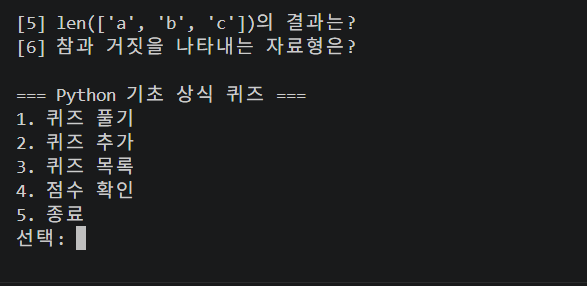
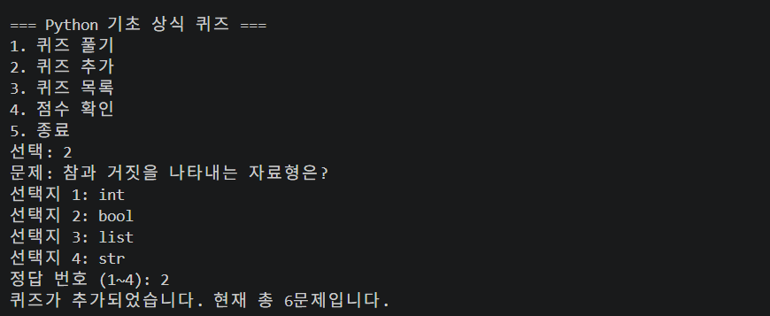
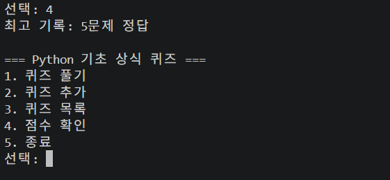
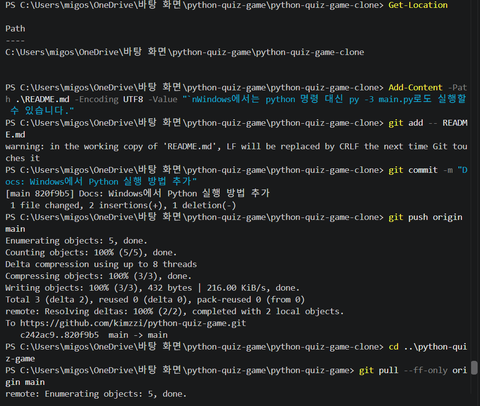
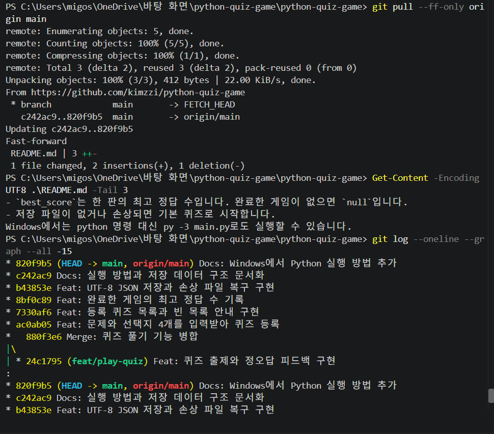

# Python 기초 상식 퀴즈

## 프로젝트 개요

터미널에서 실행하는 Python 4지선다 퀴즈 게임입니다. 기본 문제 5개를 풀고 새로운 문제를 등록할 수 있습니다. 등록한 문제와 최고 기록은 `state.json`에 저장되므로 프로그램을 다시 실행해도 확인할 수 있습니다.

## 퀴즈 주제와 선정 이유

퀴즈의 주제는 **Python 기초 문법과 자료형**입니다. 게임을 만들면서 사용한 문자열, 리스트, 딕셔너리, 함수 같은 개념을 문제를 풀며 복습할 수 있도록 이 주제를 선택했습니다.

## 실행 방법

Python 3.10 이상이 필요합니다. Python 표준 라이브러리를 사용하므로 별도로 설치할 패키지는 없습니다.

처음 실행하는 경우 GitHub 저장소를 복제하고 프로젝트 폴더로 이동합니다.

```powershell
git clone https://github.com/kimzzi/python-quiz-game.git
cd python-quiz-game
```

프로젝트 폴더에서 다음 명령을 실행합니다.

```powershell
python main.py
```

Windows에서 `py` 명령을 사용할 수 있다면 `py -3 main.py`로도 실행할 수 있습니다. 메뉴에 `선택:`이 표시되면 원하는 기능의 번호를 입력합니다.

## 기능 목록

| 번호 | 기능 | 설명 |
|---|---|---|
| 1 | 퀴즈 풀기 | 등록된 문제를 순서대로 풀고, 각 문제의 정오답과 최종 정답 수를 확인합니다. |
| 2 | 퀴즈 추가 | 문제, 선택지 4개, 정답 번호를 입력해 새 퀴즈를 등록합니다. |
| 3 | 퀴즈 목록 | 등록된 문제를 번호와 함께 확인합니다. |
| 4 | 점수 확인 | 한 판에서 가장 많이 맞힌 문제 수를 확인합니다. |
| 5 | 종료 | 저장을 시도한 뒤 프로그램을 종료합니다. |

숫자 입력에 포함된 앞뒤 공백은 제거합니다. 입력이 비어 있거나 숫자로 변환할 수 없거나 허용 범위를 벗어나면 안내 메시지를 출력하고 다시 입력받습니다. `Ctrl+C` 또는 입력 스트림 종료가 발생하면 안내를 출력하고 저장을 시도한 뒤 종료합니다.

## 실행 화면

### 퀴즈 추가

메뉴에서 `2`를 선택하고 문제, 선택지 4개, 정답 번호를 입력하면 새 퀴즈가 등록됩니다.



### 퀴즈 목록

메뉴에서 `3`을 선택하면 등록된 문제를 번호와 함께 확인할 수 있습니다.



### 퀴즈 플레이 결과

메뉴에서 `1`을 선택하면 등록된 문제가 순서대로 출제됩니다. 마지막 문제까지 풀면 전체 문제 수와 맞힌 문제 수가 표시됩니다.



## 파일 구조

```text
python-quiz-game/
├── main.py              # 입력 검사, 메뉴, 게임 진행, 저장과 불러오기
├── quiz.py              # Quiz 클래스
├── default_quizzes.py   # 기본 퀴즈 5개
├── .gitignore           # 로컬 저장 파일과 Python 캐시를 Git 추적에서 제외
├── README.md            # 프로젝트 설명
├── docs/
│   └── screenshots/     # 실행 화면과 Git 실습 캡처
└── state.json           # 게임 실행 중 생성되는 로컬 저장 파일
```

`Quiz` 클래스는 문제 하나의 내용, 선택지, 정답을 관리하고 문제 출력과 채점을 담당합니다. `QuizGame` 클래스는 퀴즈 목록과 최고 기록을 관리하며 메뉴 선택에 따라 각 기능을 실행합니다.

## 데이터 파일

`state.json`은 `main.py`와 같은 프로젝트 루트에 UTF-8로 저장됩니다. 실행 환경마다 문제와 기록이 달라질 수 있어 이 파일은 `.gitignore`에 포함되어 있습니다.

| 항목 | 형식 | 설명 |
|---|---|---|
| `quizzes` | 배열 | 저장된 퀴즈 목록입니다. |
| `question` | 문자열 | 각 퀴즈의 문제 내용입니다. |
| `choices` | 문자열 배열 | 각 퀴즈의 선택지 4개입니다. |
| `answer` | 정수 | 각 퀴즈의 정답 번호입니다. 범위는 1~4입니다. |
| `best_score` | 정수 또는 `null` | 한 판에서 가장 많이 맞힌 문제 수입니다. 완료한 게임이 없으면 `null`입니다. |

저장 파일이 없으면 기본 문제 5개로 시작합니다. 파일이 손상된 경우에도 안내 메시지를 출력한 뒤 기본 문제로 시작합니다.

## Git 작업 기록

### 브랜치 작업과 병합

기능별로 커밋을 나누어 작업했습니다. 퀴즈 풀기 기능은 `feat/play-quiz` 브랜치에서 구현한 뒤 `git merge --no-ff`로 `main`에 병합했습니다.


### 저장소 복제 (`git clone`)

GitHub 저장소를 `python-quiz-game-clone` 폴더에 복제했습니다. 복제본에서 README에 Windows 실행 방법을 추가하고 커밋한 뒤 GitHub에 푸시했습니다.

```powershell
git clone https://github.com/kimzzi/python-quiz-game.git python-quiz-game-clone
```



### 변경 가져오기 (`git pull`)

원래 프로젝트 폴더에서 `git pull --ff-only origin main`을 실행해 복제본에서 푸시한 변경을 가져왔습니다. 커밋 `820f9b5`가 반영된 뒤 README 끝에 Windows 실행 방법이 추가된 것을 확인했습니다.

```powershell
git pull --ff-only origin main
```

